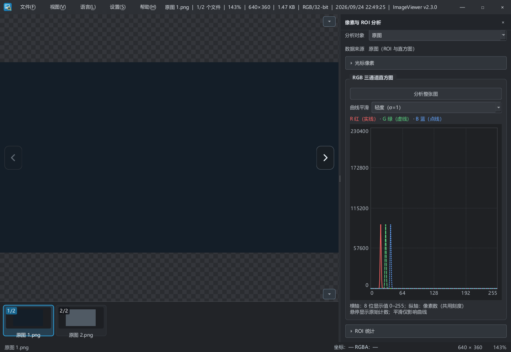

# 2026-09-24 性能优化执行与验收

按“全项执行”落实 [性能与产品问题评估](260924性能与产品问题评估.md) 的 P01–P10。保持现有高性能看图定位，不恢复文件名搜索、缩略图大小选择或自动整图分析。

## 执行结果

| 编号 | 落地内容 |
| --- | --- |
| P01 | 缩放标题使用后台读取的文件大小和时间；图像类型按格式/有限调色板判断，不扫描 RGB 全图。ROI 同样不再先扫描整图，增加 Gray8/BGR888 行读取路径。RGB 编码的灰图显示三通道统计。 |
| P02 | 先显示当前图，目录独立后台扫描、自然排序并作废旧请求；路径索引使用哈希表。缩略图从 QListWidget 改为 QListView 数据模型，按需生成名称和序号，批量布局，不逐张创建列表项对象。 |
| P03 | 同进程窗口共享 384 MiB 解码 LRU；同路径/版本的并发解码合并。预加载仅考虑最近的前后各一张，逐张完成并入缓存，不保留整批结果。按每像素最多 8 字节估算，超过 96 MiB 或尺寸未知时跳过投机解码；当前图超过该门槛时不预加载邻图。 |
| P04 | 当前解码、预加载、计算、缩略图、目录、保存分开调度；线程池在进程内共享，线程数量分别为 2/1/2/1/1/1。预处理阶段、金字塔层级、目录遍历、缩略图批次及预加载之间可协作取消。任务不捕获窗口，关闭窗口不再等待观察者；最终进程退出前仍安全收尾不可中断的解码/I/O。 |
| P05 | 磁盘缓存记录增量字节数；初始化、累计 128 次写入或超过 256 MiB 时校准/清理，超限时清到 90% 留余量，避免在上限附近每张触发扫描。同进程窗口共用维护锁和计数。 |
| P06 | 保存不可变图像快照，在独立后台队列完成编码和 QSaveFile 原子提交；期间可切图，同一窗口不能重复发起保存。仅失效目标文件解码缓存、刷新相关缩略图和后台目录。保存中关闭窗口会继续响应并在成功后关闭，失败时留在窗口显示原因。 |
| P07 | 去掉普通加载后紧接着恢复原图的重复 setImage；每次普通打开仅提交一次显示。显示金字塔仅在大图缩小查看时请求，过期工作按层检查取消。 |
| P08 | 高位深图状态栏明确取样/统计/处理为 8 位，光标显示“8 位显示值（非原始值）”；直方图横轴说明同步。默认参数直通保留原始图像与位深，实际预处理仍为 8 位。 |
| P09 | 默认处理直接共享原图；实际颜色处理后恢复输入 Alpha，PNG 导出保留透明度。透明覆盖率不参与颜色滤波、不改变；透明边界颜色采用现有颜色算法。 |
| P10 | README 统一安装 EXE/便携 ZIP 说明，分别列出尚无代码签名、自动更新；补充性能行为、精度边界和测量入口。英文翻译同步。 |

## 测试与测量

在 Windows、Intel Core Ultra 5 125H（18 逻辑处理器）、约 32 GB 内存上验证。

新增 TEST-56–67，覆盖透明度与导出、默认参数共享、取消、并发去重、单文件失效、大图预加载门槛、16 位提示、目录阻塞时首图显示、后台保存快照、五万文件模型、ROI 通道准确性、保存失败、保存中关闭、关闭窗口生命周期、缩略图清理频率。

原有 3 项测试改为分别等待主图与目录完成，保持损坏图恢复、拖放导航及首尾按钮断言；主图先出现是本次的预期行为。

可重复执行：

```powershell
.\scripts\build.ps1 -Cfg Debug
.\bin\Tests\Debug\ImageViewerCoreTests.exe
.\scripts\build.ps1 -Cfg Release
.\bin\Tests\Release\ImageViewerCoreTests.exe
.\bin\Tests\Release\ImageViewerCoreTests.exe --benchmark
.\scripts\check-bom.ps1
```

基准生成两张 2448×2048 的 BMP（RGB 编码灰图和彩色图），使用 1320×860 离屏窗口；冷/热应用缓存各 20 次，统计请求到首次 QGraphicsView 绘制完成的中位数/P95，另记录 10 ms 心跳的最大实际间隔、峰值工作集和末尾私有内存。两张图分置于两个测试目录以隔离邻图预加载。冷缓存只清应用解码缓存，系统文件缓存仍可能命中。此结果不等于真实显示器呈现延迟，也不代表网络目录或超大图表现。

日常诊断可设置 `IMAGEVIEWER_PERF_TRACE=1`，日志输出解码就绪、目录就绪、首帧耗时及共享缓存命中/解码次数；默认关闭，不在主线程写性能文件。

最终结果：

- VS2019 x64 Debug、Release 构建成功；两种配置各 **67 项通过，0 项失败**。新增测试范围包括 TEST-56–67。
- 英文翻译 191 条，0 条未完成；`git diff --check` 通过。已运行编码检查，新头文件为 UTF-8 BOM；既有未改源文件仍保留其原有 UTF-8 无 BOM 编码。构建有 Qt 模板常量条件警告，无编译错误。
- Release 微测量：五万项模型设置 2 ms；200 次缩放信息更新总计 9 ms。这些只测对应操作，不包含完整目录扫描或屏幕呈现。

| 2448×2048 BMP，Release 离屏基准 | 样本 | 首帧中位数（上中位） | P95 | 测量阶段解码/缓存命中 |
| --- | --- | --- | --- | --- |
| 冷应用缓存 | 20 | 241 ms | 366 ms | 20 / 0 |
| 完整预热后的应用缓存 | 20 | 101 ms | 135 ms | 0 / 20 |

本次峰值工作集约 **99.6 MiB**，末尾私有内存约 **64.5 MiB**；10 ms 心跳的最大实际间隔为 **216 ms**，包含 UI 工作与系统调度影响，说明首帧呈现仍有进一步优化空间，不能宣称“零停顿”。这些是合成样本的单次运行结果，非与旧版对照的提速比例。

已修正基准预热步骤：冷阶段结束后显式预热两张，再开始热缓存采样，热阶段 20 次均命中；初次探索中混入一次冷解码的数据不作为最终表格依据。

原始日志保留在忽略目录 `obj/260924-perf-*.log`。

## 可视检查与限制

下图为最终 Release 自动回归使用合成图生成的离屏截图，已检查中文文本、列表模型缩略图、序号和直方图说明的布局。



桌面验收工具重置后能枚举窗口，但实际截图显示 Windows 锁屏，依照 computer-use 技能停止桌面输入。本轮没有把离屏回归算作真实桌面人工验收。待解锁复测：资源管理器拖放、快速连续翻图与反向切换、真实滚轮缩放和高倍率拖动、全屏/面板显隐、透明图保存、不同 DPI/多显示器。无需为此暂停已授权的代码和自动验收工作。

边界说明：

- 384 MiB 约束共享解码缓存，不是整个进程内存；当前图、QPixmap、工作区、金字塔及各窗口仍占内存。编码器内部单次解码/缩放/滤波不能在任意指令中途取消，进程最终退出可能等待其完成。
- 多个独立进程各有内存预算；磁盘缓存按周期校准其他进程的写入，跨进程不是实时总量锁定。
- P08 按评估建议先消除读数语义歧义。原始 10/12/16 位测量、窗宽窗位及完整高位深处理/导出没有在本次隐式扩展；另存原图能否保留精度由目标编码器决定。
- 本轮不承诺相对旧版提升百分比；没有在同一测量框架下重跑旧版，也未在线重新核验 GitHub 附件或执行干净系统安装。

## 后续集中回复区

- 原始高位深需求：仅看图 / 需要原始值取样统计 / 全链路保留精度：
- 实际常用与最大尺寸、文件格式、单目录数量、本地或网络路径：
- 解锁后人工体验发现的问题：
