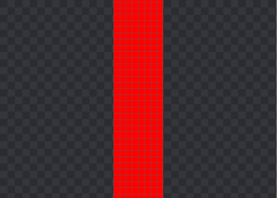

# 2026-09-24 看图界面与像素格优化

## 本轮修改

1. 像素网格出现时（缩放 ≥ 800%），光标旁显示坐标及 BGR 数值；灰度格式显示单值。对比分割图按光标所在一侧取样，缩小、移出图像或进入其他控件时隐藏提示。
2. 主工具栏默认隐藏，图像区右上角保留展开箭头；展开后可用工具栏最右端箭头收起。另有“视图 → 显示工具栏”和 Ctrl+Shift+T。
3. 缩略图默认显示，图像区右下角的箭头可收起/展开，隐藏后入口仍在。保留 Ctrl+T 和视图菜单。
4. F11 全屏只保留顶部标题栏、底部状态栏和图像，暂时隐藏工具栏、缩略图、侧面板、翻图箭头、展开按钮、滚动条及局部放大镜。F11 / Esc 退出后恢复此前布局和普通/最大化状态；键盘左右键仍可翻图。
5. 修复上下拖动时棋盘格背景被拼成条纹：滚动后重新绘制背景区域。透明图需要重绘其下方背景；不透明图像内部继续复用滚动像素，不重新解码或重建金字塔。

## 性能约束

光标提示只取一个像素，检查灰度格式或至多 256 项调色板，不扫描整图；复用同一个提示控件，文本相同时不重排。不增加自动分析任务、后台轮询或新的图像缓存。背景重绘只在滚动事件中请求，并由 Qt 合并刷新。

## 产品约定（后续可在此统一回复）

- “底部标题栏”按现有状态栏理解；顶部标题栏中的文件/视图等菜单仍保留。
- 默认显隐用于没有保存设置的首次启动，之后记住用户选择；旧版工具栏布局状态不会覆盖新的默认隐藏规则。
- 灰度指灰度编码或灰度调色板图像。RGB 编码的等值三通道图仍显示 BGR，不为区分这种情况增加整图扫描。
- 数值沿用现有 8 位显示/处理链路（0–255），本轮不增加高位深原始值模式。
- 全屏隐藏分析会沿用已有取消统计行为，退出后恢复面板可见性，统计仍需手动触发。

## 验证记录

新增 TEST-52–55，覆盖 BGR/灰度及对比来源、提示隐藏、两组显隐控制、非整格距离背景重绘、全屏退出恢复。

- VS2019 Debug：构建成功，55 项通过，失败 0 项。
- VS2019 Release：构建成功，55 项通过，失败 0 项。
- 英文翻译 187 条有效文本，未完成项为 0；编码检查与 `git diff --check` 完成。
- 合成窄幅图反复按非整格距离上下移动后，背景区域重绘检查通过，截图仍为规则方格。光标提示的截图确认 BGR 顺序与预设像素 (12,34,56) 一致。

实际桌面验收尝试启动了专用合成窄幅图窗口，桌面控制返回 `GetCursorPos failed: 拒绝访问 (0x80070005)`，截图为黑屏，因此不计为人工验收通过。窗口已关闭，未操作用户其他软件。真实鼠标拖动、资源管理器拖放和多显示器复测留待桌面可访问时进行；自动回归仍覆盖 Qt 拖放事件、缩略图、像素网格和显隐。

日志保留于忽略目录 `obj/260924-*-build.log`、`obj/260924-*-tests.log`；截图使用自建测试图。
