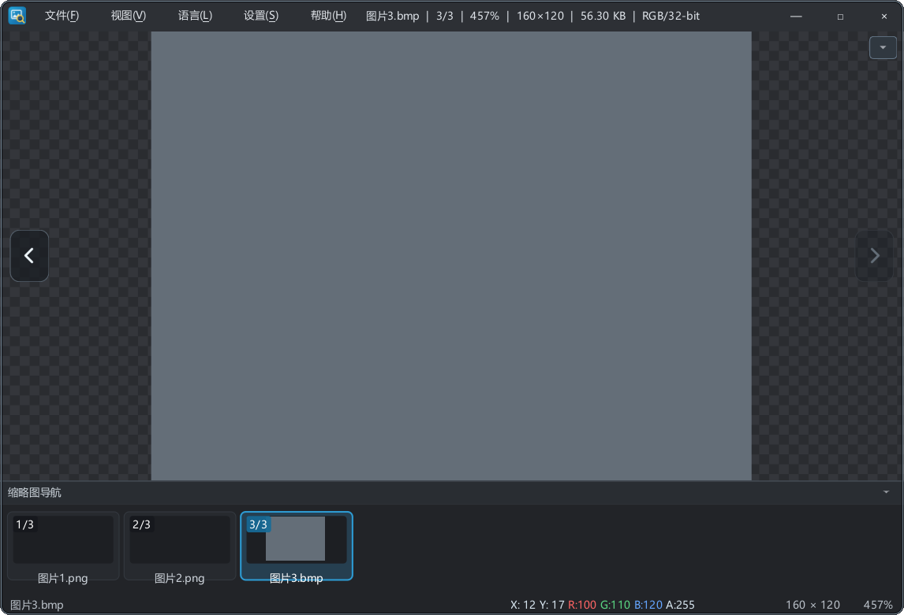
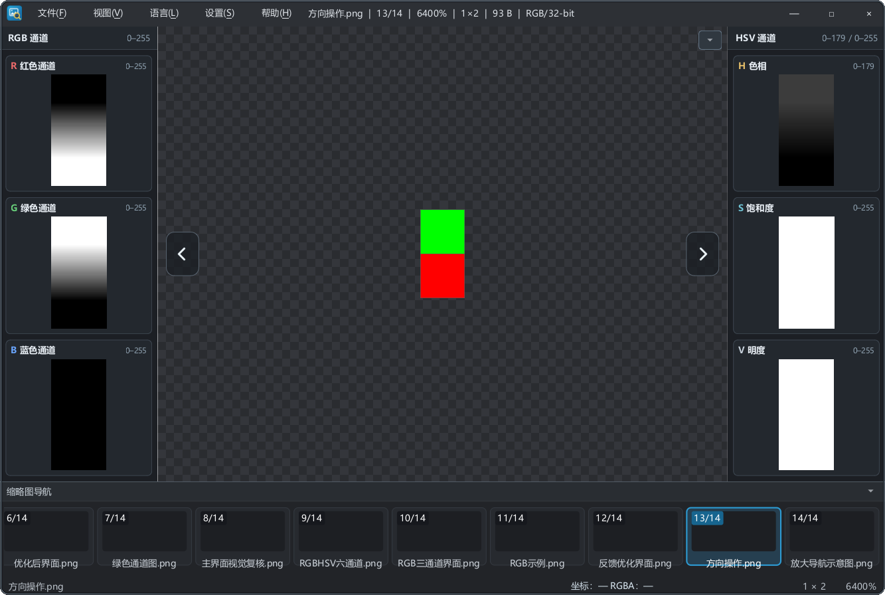

# 261027 通道并排视图与窗口边框优化

## 背景

1. 通道拆分原先在独立对话框中，切换图片后不刷新，也不适合长时间边看主图边看通道。
2. 单张六宫格布局削弱了主图的可视面积和缩放能力，需要改为“中间主图 + 两侧通道卡片”。
3. 用户要求窗口改为圆角并保留清晰边界线；此前取消圆角遮罩后四角为直角。

## 交互与布局

- **通道并排视图**
  - “拆分通道看图（RGB / HSV）”为可勾选动作，快捷键 `Ctrl+Shift+C`，状态保存到 `ui/channelSplit`。
  - 开启后主视图保持居中并继续支持滚轮缩放、拖动、像素读数与翻图；左右各出现一列固定宽度卡片。
  - 左侧 RGB：R、G、B 三张竖向卡片；右侧 HSV：H、S、V 三张竖向卡片，各通道以灰度显示。
  - 卡片标题使用通道字母配色，右上角标注取值范围（H 为 0–179，其余 0–255）。
  - 换图、预处理完成、旋转/镜像后自动后台刷新；旧结果按代数作废。
  - 全屏时隐藏两侧通道，退出全屏恢复；最大化不受影响。
  - 通道缩略图限制在 512×384 内生成，内存占用有界。

- **圆角窗口与边界线**
  - 恢复 12px 圆角窗口遮罩。
  - 边框改为“路径相减生成的 1px 描边环”，整体内缩 1px，因此不会被圆角遮罩裁切。
  - 外层浅灰 `(124,141,156)` + 内层深色压边，四边宽度一致；最大化/全屏自动隐藏边框并解除遮罩。
  - 实际运行窗口通过 `GetWindowRgn` 验证：区域类型为复杂区域，左上角 `(1,1)` 不在区域内、左边中点与中心在区域内，即圆角生效。

- **其他**
  - 窗口标题栏保持紧凑（不含版本号与修改时间），修改时间在状态栏文件名悬浮提示中。
  - 通道开启时状态栏继续显示中间主图的缩放比例与像素读数。

## 视觉效果

## 验证

- Debug 与 Release 构建通过；核心回归均失败 0 项（72 项）。
- 覆盖用例：
  - `TEST-27` 普通窗口圆角遮罩与边框显示，最大化解除遮罩，还原后恢复。
  - `TEST-71` 中间主图可缩放，左侧 RGB / 右侧 HSV 竖向排列，换图自动刷新，全屏隐藏、退出恢复。
  - `TEST-72` 通道并排视图作为持久化参数，重建窗口后打开图片自动恢复。
- 真实 Windows 窗口取样：四边均存在 `(124,141,156)` 外描边与 `(12,16,20)` 内描边；圆角区域检查通过。
