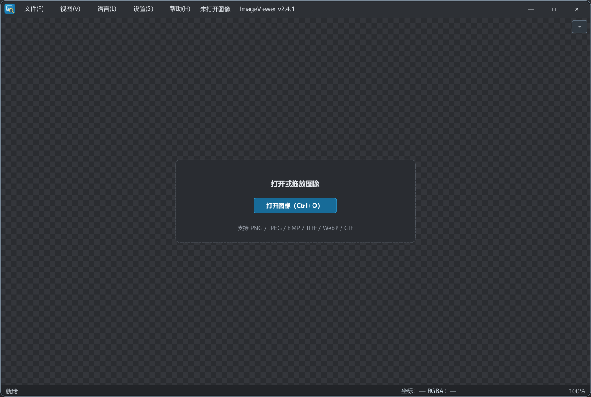
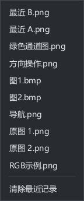
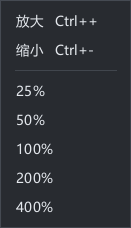
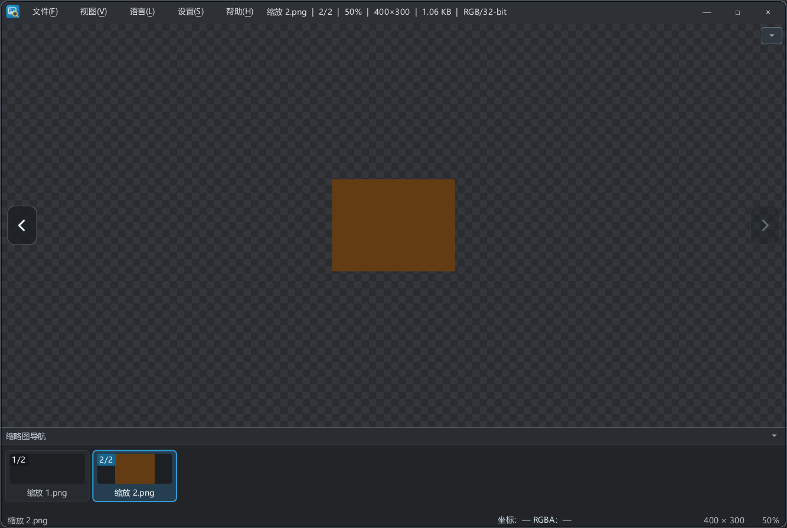

# 261111 成熟度提升与视觉复核

## 背景与研判

以“可交付的成熟产品”为标准，对当前版本做了一轮体验与工程审视，优先处理影响首次使用、长期使用和可发现性的短板：

- 首次启动只有一段虚线卡片，缺少可直接点击的入口；“最近打开”缺失，重复查看同一批图片需要每次找目录。
- 查看长图时只有“适应/100%”，缺少常见缩放档位；首尾跳转与 PgUp/PgDn 翻图缺失。
- 长文件名/高 DPI 下标题栏信息被硬截断，既看不清也无法确认完整信息。
- 空状态下底部仍保留缩略图区域，浪费垂直空间。
- 缩略图只能左键切换，缺少与主图一致的右键操作（定位文件夹、复制文件）。
- README 仍描述旧版单实例转发与右下角缩略图按钮，与当前多进程、标题栏折叠行为不一致。

## 本次改进

1. **最近打开**
   - 文件菜单新增“最近打开”，最多 10 项，按最新使用排序并持久化到 `files/recent`。
   - 文件失效时给出状态栏提示并自动从列表移除；支持“清除最近记录”。
2. **空状态入口**
   - 空图像时在虚线卡片内显示“打开图像（Ctrl+O）”按钮，点击直接打开文件对话框。
   - 无图片时自动隐藏缩略图容器，把空间还给空状态；打开图片后恢复。
3. **缩放与导航**
   - 新增 25%、50%、100%、200%、400% 缩放预设，以及 Ctrl+= / Ctrl+- 放大缩小。
   - Home / End 跳转首尾，PgUp / PgDn 翻图；视图菜单与右键菜单均可访问缩放档位。
4. **标题栏省略**
   - 标题信息按可用宽度右侧省略，悬浮提示保留完整路径与完整标题，不再硬截断。
5. **缩略图右键**
   - 打开、打开所在文件夹、复制图像文件，与主图操作保持一致。
6. **文档与翻译**
   - README 更新为当前多进程与标题栏折叠行为，并补充最近打开、缩放档位、Home/End、PgUp/PgDn 说明。
   - 英文翻译补齐新增文案，`lrelease` 报告 237 条、未完成 0 条。

## 视觉复核

复核结论：

- 空状态卡片居中，主按钮层级清晰，底部不再出现空缩略图条。
- 最近打开最多 10 项，菜单宽度稳定，清除入口与列表分隔明确。
- 缩放菜单快捷键、档位分组清晰，与视图菜单保持一致。
- 主图缩略图文字位于卡片边框内；标题栏超长信息省略后以“…”结束，窗口按钮不再压住圆角边框。

## 验证

- Debug 与 Release 构建通过，核心回归 **76 项全部通过**。
- 新增覆盖：
  - `TEST-75` 最近打开排序、持久化、失效剔除与清除。
  - `TEST-76` 空状态打开按钮、标题省略、缩放预设与快捷键、Home/End、缩略图右键策略。
- `check-bom.ps1` 通过；`lrelease` 无未完成翻译。
